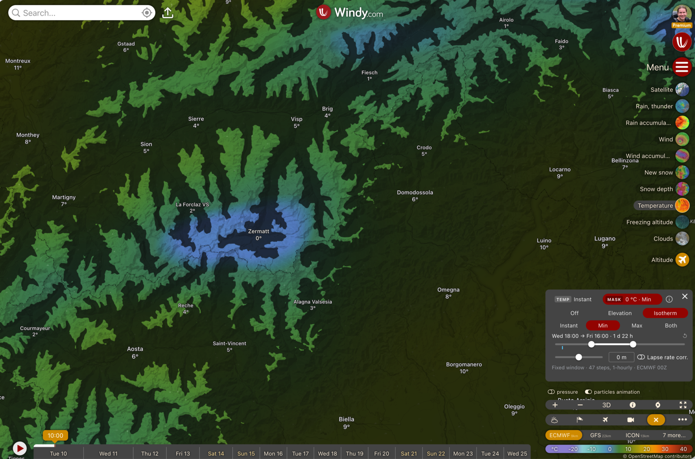
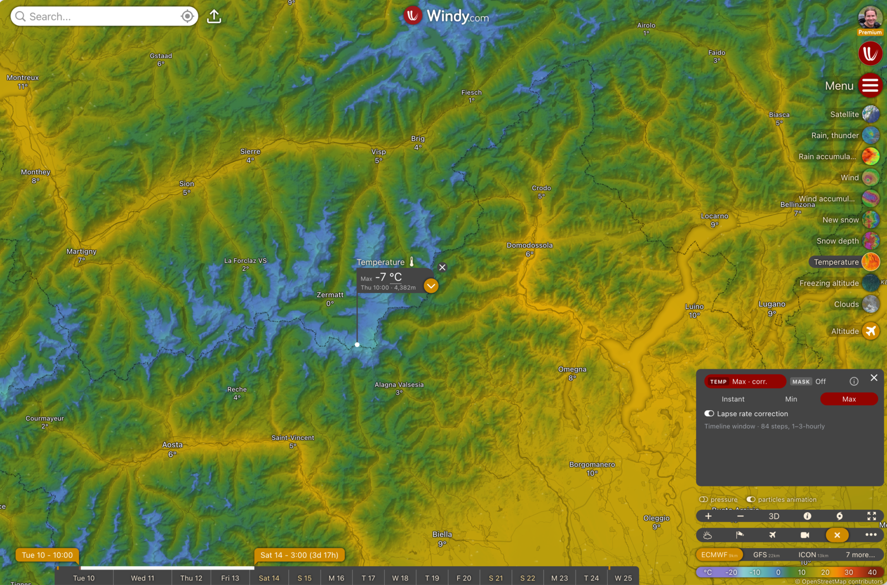
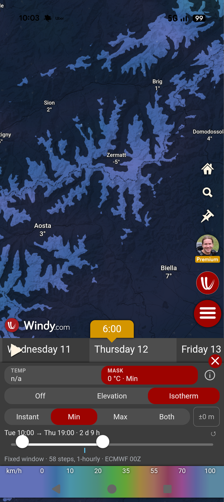

# Alpine planner

**Planning tools for the mountains, as a [Windy](https://www.windy.com) plugin.** Alpine planner adds a temperature
tool and a terrain mask to Windy's map. The temperature tool shows the lowest or highest temperature over a time
window instead of a single moment, and can move it from the forecast model's smoothed ground to the real terrain
height. The terrain mask dims the terrain you can rule out, by altitude or by the forecast freezing level, on top of
any Windy layer. The temperature tool follows Windy's selected model; the isotherm mask uses ECMWF when that model
does not provide a freezing level.







## Features

The panel has two tools, **TEMP** and **MASK**, each tab showing a short summary of its state. The **(i)** button
opens the in-app help on the selected tool's page.

### Temperature tool (TEMP)

Works with Windy's **Temperature** layer at the surface; on any other layer it pauses and offers a **Show
temperature** button.

- **Instant:** Windy's own temperature at the timeline time.
- **Min / Max:** the lowest or highest 2 m temperature over a time window. Windy's timeline turns into its **range
  selector**: drag the window and set its length. Only the model's own forecast steps are compared (nothing is
  interpolated in time); the status line shows how many steps were used and how far apart they are. Free Windy
  accounts get the steps up to the end of the free forecast, and the panel says when the window was cut.
- **Lapse rate correction** (off by default): the model's temperature is valid at its smoothed ground, often hundreds
  of metres above real valleys and below real summits. The correction moves it to the **real terrain height**
  (about 90 m elevation data), using the model's own temperatures higher up in the air; below the model ground it
  follows the free air. Valleys and ridges then show up in the colours. With Min / Max, every step is corrected
  first, then the extreme is taken. Available for models that provide pressure levels and their terrain height
  (e.g. ECMWF, GFS, ICON, ICON-EU, ICON-D2, UKV); otherwise the toggle says it's not available with that model.

### Terrain mask (MASK)

- **Off**, **Elevation** or **Isotherm**.
- **Elevation:** terrain between two altitudes stays clear, everything else is dimmed. Set the range with the slider
  or type into the number fields (500 m to 8 000 m, 10 m steps; the top position means "no upper limit"). Doesn't
  depend on the forecast.
- **Isotherm:** terrain above the forecast freezing level (0 °C) stays clear, terrain below it is dimmed. It uses
  the model selected in Windy if it provides a freezing level (ECMWF, ICON, ICON-EU, ICON-D2, UKV), otherwise ECMWF;
  the status line names the model and run.
  - **Instant:** at Windy's timeline time.
  - **Min / Max / Both** over a time window set with the plugin's own slider (independent of Windy's timeline; a blue
    tick marks the timeline time, ↺ resets the window to the timeline time + 12 h):
    **Max** keeps terrain above every sampled effective freezing level clear, **Min** keeps terrain above at least
    one clear, and **Both** shows the two together. The labels “stayed frozen” and “froze and thawed” describe this
    threshold classification, not measured air or snow conditions; between grid nodes the displayed bands are
    interpolated envelopes.
  - **Offset:** moves the line up or down by up to 500 m, as a safety margin or a rough snow line.
  - **Lapse rate correction** (off by default): where the air is frozen down to the model's smoothed ground, the
    model can't say how far below it the 0 °C level lies. The correction estimates it from the free air, so deep
    valleys below the model ground are judged at their real height.
- Both masks draw on top of any Windy layer and work at every zoom.

### Picker labels

With Min / Max, Windy's picker shows **Max** or **Min** before the interpolated node extreme. Its second line gives
the time when the separately interpolated point forecast reaches its extreme. **The displayed temperature need not
occur at that time**, because the value combines neighbouring nodes' extremes, which may occur at different steps.
With the lapse rate correction it also shows the **height** used, in Windy's units ("Wed 14:00 · 1,840 m"; in Instant
just the height). The corrected picker evaluates neighbouring profiles at that absolute height, while the map uses
heights relative to each node's model terrain. Their values can differ by several degrees; see the
[algorithm and example](docs/forecast-layer-algorithm.md#76-from-bands-to-the-map).

### Remembered state

The plugin remembers your elevation range and isotherm offset. Reopened within **60 minutes** of its last use (an
accidental close, another plugin and back, a page reload), it comes back exactly as you left it: the selected tool,
the modes, the corrections and the isotherm window. After that it opens in its default state, with your range and
offset kept.

## Install

Alpine planner is listed in Windy's plugin gallery. On [windy.com](https://www.windy.com), open Windy's main menu,
go to the plugins section (the plugin gallery), find **Alpine planner** and install it. Once installed, it opens from
Windy's menu. It works in desktop and mobile browsers.

## Limits and safety

**Alpine planner is a planning aid, not a safety tool.** It knows nothing about snow cover, snow quality, avalanche
danger or ice conditions. Always check the avalanche bulletin and local observations.

- **Forecasts, not measurements.** Everything comes from one run of one model.
- **Air, not snow.** The freezing level and the temperatures describe the air. Snow can stay frozen in air above
  0 °C (clear nights, shade) or soften below it (strong sun).
- **Forecast steps only.** Min and Max compare the model's steps, 1–6 hours apart. Sampling can miss maxima, minima
  and short thaws between steps. Spatial interpolation adds separate error, so the displayed maximum is not
  guaranteed to be too low, or the minimum too high.
- **Multiple freezing levels.** A single freezing-level field cannot describe every warm and cold layer. A cold
  valley beneath a warm layer can be dimmed; the provider's crossing-selection rule has not been verified per model.
- **Model resolution.** Models work on grids of a few kilometres. Valley cold pools, foehn, and sun or shade on a
  single slope can be missed or misplaced.
- **Below the model ground, it's an estimate.** The lapse rate correction follows the free air. Deep valleys on clear
  nights are often several degrees colder than it shows; under warm air aloft they can also look too warm.
- **Terrain detail.** About 90 m elevation data: narrow ridges, couloirs and small summits are smoothed.

The methods, their assumptions and the open questions for meteorologists are documented in
[`docs/forecast-layer-algorithm.md`](docs/forecast-layer-algorithm.md) and
[`docs/freezing-mask-algorithm.md`](docs/freezing-mask-algorithm.md).

## Privacy

- **No tracking and no analytics.** The plugin collects nothing and has no server of its own.
- **Settings stay in your browser,** in its local storage (`windy-plugin-alpine-planner:state`), and are never
  uploaded.
- **Forecast and terrain tiles** are loaded from Windy's tile servers, the same way Windy's own layers load them.

## For developers

### Requirements

- [Node.js](https://nodejs.org) 26 (the version in [`.nvmrc`](.nvmrc); `nvm use` picks it) and npm.
- A browser with WebGL2, and a Windy account for developer mode.

### Setup and running the plugin in Windy

```sh
npm ci
npm start      # rollup in watch mode, serving dist/ on https://localhost:9999
```

1. Open <https://localhost:9999/plugin.js> once in your browser and accept the self-signed development certificate
   (otherwise Windy can't load the plugin over HTTPS).
2. Log in on windy.com, open [windy.com/developer-mode](https://www.windy.com/developer-mode) and load the plugin from
   `https://localhost:9999/plugin.js`. It registers as **Alpine planner**.
3. Rollup rebuilds on every change; reload the plugin from developer mode to pick it up.

### Scripts

| Script | Does |
|---|---|
| `npm start` | builds in watch mode and serves `dist/` over HTTPS on port 9999 |
| `npm run build` | a production build into `dist/` (`plugin.js`, `plugin.min.js`, `plugin.json`) |
| `npm run lint` | ESLint over `src/`, `e2e/` and the Playwright config |
| `npm run typecheck` | `tsc --noEmit` for the plugin and for the end-to-end tests |
| `npm test` | the unit tests |
| `npm run test:e2e:check-credentials` | fails unless both E2E accounts are configured; used before release/nightly browser tests |
| `npm run test:e2e` | builds, then runs the end-to-end tests in a real Windy (see below) |
| `npm run test:e2e:headed` | the same in a visible browser |
| `npm run test:e2e:report` | opens the last end-to-end run's HTML report |
| `npm run test:e2e:scan-report` | checks the last run's report and results for credentials |

### Project structure

```
src/plugin.svelte                  the panel: the two tools, the help, the remembered state
src/pluginConfig.ts                the plugin's id, version and UI placement in Windy
src/features/forecastLayer/        the temperature tool: Min / Max, the lapse rate correction, the layer, the picker,
                                   and windyHooks.ts, the only module that patches Windy
src/features/elevationMask/        the terrain mask: Elevation and Isotherm (Instant and over a time window)
src/features/help/                 the in-app help
src/lib/, src/ui/                  shared pure modules (steps, profile, tiles, state) and controls
e2e/                               the end-to-end tests (Playwright)
docs/                              algorithm and integration documentation
publish.sh                         packages and uploads the plugin to Windy's gallery
```

### Debug mode

In the browser console on windy.com, set `localStorage['windy-plugin-alpine-planner:debug'] = '1'` and reopen the
plugin. A floating debug window (top left, collapsible) shows tile and loading counters, the data behind the layers,
and the values under the cursor: for the isotherm mask the freezing level, the model terrain and the branch of the
rule; for the temperature layer every step's value and the corrected profile. Remove the key to turn it off.

### Test API

For the end-to-end tests, `localStorage['windy-plugin-alpine-planner:test'] = '1'` exposes a read-only object while
the plugin is open (`src/lib/testApi.ts`). Tests read through it and drive the UI like a user; there are no setters.

```ts
window.__alpinePlanner = {
    version,     // the plugin's version
    state(),     // { tool, temp: { mode, correction }, mask: { mode, isoMode, isoCorrection, window }, values: { from, to, offset } }
    status(),    // { temp: string[], mask: string[], loading: { temp, mask }, failed: { temp, mask } }: the status lines
    hooks(),     // which Windy patches are in place, and whether the interpolator and user control are Windy's own
    boxSize(),   // { width, height } of Windy's box around the plugin
};
```

### Unit tests

`npm test` runs Node's built-in test runner on `src/**/*.test.ts` and `e2e/*.test.ts` (with type stripping, no extra dependencies). The
pure modules are covered: the freezing level rule, the temperature profile and the correction, the height bands, the
step selection and the min/max folds, the isotherm window, the status lines, number parsing and the remembered state.
The E2E security unit tests use synthetic credentials and temporary artifacts to check the upload scanner and the
CI credential preflight; they do not log in to Windy.

### End-to-end tests

A [Playwright](https://playwright.dev) suite (`e2e/`, `playwright.config.ts`) runs the built plugin **inside a real
Windy** (www.windy.com by default), logged in with dedicated free and premium test accounts. It covers loading
through developer mode, the panel and its 320 × 200 box, the Windy patches and every way of restoring them, the
picker, the masks and their tiles, the isotherm window, the free forecast horizon, the remembered state and the mobile
layout. It doesn't check meteorological values (the unit tests do) or real GPUs and phones (the tests run on
software WebGL in Chromium with a phone profile).

**Setup:**

1. `npm ci`, then `npx playwright install chromium`.
2. Copy `.env.example` to `.env` (git-ignored) and fill in the test accounts (`WINDY_FREE_USER`,
   `WINDY_FREE_PASSWORD`, `WINDY_PREMIUM_USER`, `WINDY_PREMIUM_PASSWORD`), or set them in the environment. A missing
   account skips its projects locally with a message naming the variables. Release and nightly CI run a preflight
   that fails unless all four account variables are set, so those workflows cannot pass with this coverage skipped.
3. Optionally `WINDY_URL` (default `https://www.windy.com`, no trailing slash) selects another Windy client to test.
   The plugin always loads its tiles from Windy's production tile server.

**Projects and tags:**

| Project | Account | Device | Runs |
|---|---|---|---|
| `setup-premium`, `setup-free` | | Desktop Chrome | the login (`e2e/auth.setup.ts`); the projects below depend on them |
| `desktop-premium` | premium | Desktop Chrome, 1440 × 900 | every spec but `mobile`, without `@free` |
| `desktop-free` | free | Desktop Chrome, 1440 × 900 | every spec but `mobile`, without `@premium` |
| `mobile-free` | free | Pixel 7 profile (Chromium) | `mobile.spec.ts` |
| `noauth` | none | Desktop Chrome | `@noauth`: the plugin route on Windy's page, without logging in |

`@free` and `@premium` mark tests that need that account; `@noauth` needs none. Pass Playwright options after `--`,
e.g. `npm run test:e2e -- --project=desktop-premium`. Tests run serially (the accounts share state on Windy's side)
and wait on the test API, never on fixed delays.

**How it works:** no dev server; the tests route `https://localhost:9999/plugin.js` to `dist/plugin.min.js` and load
it through Windy's developer mode. Each login is saved under `e2e/.auth/` and reused for 12 hours. If Windy's login
asks for a challenge, run `npm run test:e2e:headed` once and complete it by hand (the login waits 90 s).

**Credentials and artifacts:**

- Login credentials are read from the environment or `.env`, and text attached to the report is redacted. Saved
  authenticated browser state is separate and must be treated as secret (see below).
- **No traces, videos or page screenshots** are recorded: a Playwright trace contains request headers, cookies and
  storage, which hold the session token. The login projects record nothing at all. On failure, the specs attach
  screenshots of **the plugin box and Windy's picker only** (Windy's header shows the account), and a failed test's
  `error-context.md` has no page snapshot.
- Saved sessions (`e2e/.auth/`), `test-results/` and `playwright-report/` are git-ignored, never commit or share
  `e2e/.auth/`.
- After a run with real accounts, `npm run test:e2e:scan-report` must report nothing found. It checks usernames,
  passwords and email domains in artifact contents and filenames, plus `token` markers in report data and
  attachments. It also checks exact credential values in the HTML viewer, where the viewer's own code contains
  harmless `token` text. It prints counts only and fails if artifacts are missing or report data cannot be read.
  CI uploads artifacts only after this scan passes. This is a guard against accidental disclosure, not a guarantee
  of detecting arbitrary session secrets, encoded values or text visible only in an image.

**Caveats:** forecasts change hour by hour, so the tests check structure (steps, loading, failures, patches), not
values. A Windy release can break the plugin's patches of Windy's client; the forecast-layer specs catch exactly that,
which is why CI runs the suite every night (see [`docs/windy-integration.md`](docs/windy-integration.md)).

### Continuous integration and releases

| Workflow | When | Does |
|---|---|---|
| `ci.yml` | pull requests, pushes to branches other than `main` | lint, typecheck, unit tests, build; no secrets |
| `release.yml` | pushes to `main`, manual | the CI checks and the end-to-end tests; then publishes through the `release` environment (approval requires the setup below), and tags the version `v<version>`, unless that tag already exists |
| `nightly.yml` | daily, manual | the end-to-end tests against windy.com |

To release, raise the version in both `package.json` and `src/pluginConfig.ts` (a unit test checks they match), add
it to [`CHANGELOG.md`](CHANGELOG.md) and merge to `main`. `./publish.sh --dry-run` packages the plugin locally without
uploading.

**Maintainer setup for a new GitHub repository, before the first release:**

1. Add `WINDY_FREE_USER`, `WINDY_FREE_PASSWORD`, `WINDY_PREMIUM_USER` and `WINDY_PREMIUM_PASSWORD` as repository
   Actions secrets. The test jobs do not use the `release` environment, so secrets stored only there are unavailable
   to the credential preflight and browser tests. Pull-request CI uses no secrets.
2. Create the `release` environment, restrict deployment to `main`, and configure **required reviewers**. Store
   `WINDY_API_KEY` and `WINDY_PLUGIN_OWNER` as that environment's secrets. The YAML reference alone does not require
   approval: GitHub can create an unprotected environment automatically. See
   [GitHub's environment setup](https://docs.github.com/en/actions/how-tos/deploy/configure-and-manage-deployments/manage-environments).
3. Enable **private vulnerability reporting** in the repository's security settings and verify that the private
   reporting link in [`SECURITY.md`](SECURITY.md) works for a signed-in non-maintainer.

These are repository settings, not configuration installed by cloning these files. The publish job is restricted
to `tomas-mazak/windy-plugin-alpine-planner`; maintainers of a fork must explicitly adapt that guard and its secrets
before using automatic publishing.

### Documentation

- [`docs/forecast-layer-algorithm.md`](docs/forecast-layer-algorithm.md): how the temperature minimum / maximum and
  the lapse rate correction are computed.
- [`docs/freezing-mask-algorithm.md`](docs/freezing-mask-algorithm.md): how the effective freezing level is computed.
- [`docs/windy-integration.md`](docs/windy-integration.md): how the plugin hooks into Windy, and how it undoes it.
- [`docs/README.md`](docs/README.md): the index, and the rule that every change to the meteorological processing
  updates its document.

## Contributing, security and licence

- Contributions are welcome; see [`CONTRIBUTING.md`](CONTRIBUTING.md).
- Please report security issues privately, as described in [`SECURITY.md`](SECURITY.md).
- Licensed under the [MIT licence](LICENSE). The build setup is derived from Windy's
  [windy-plugin-template](https://github.com/windycom/windy-plugin-template) (ISC); see
  [`LICENSES/windy-plugin-template.txt`](LICENSES/windy-plugin-template.txt).
- The gallery bundle includes Svelte's MIT runtime notice and this project's licence. See
  [`LICENSES/README.md`](LICENSES/README.md) for attribution and packaging details.
