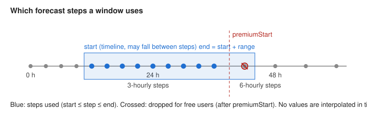
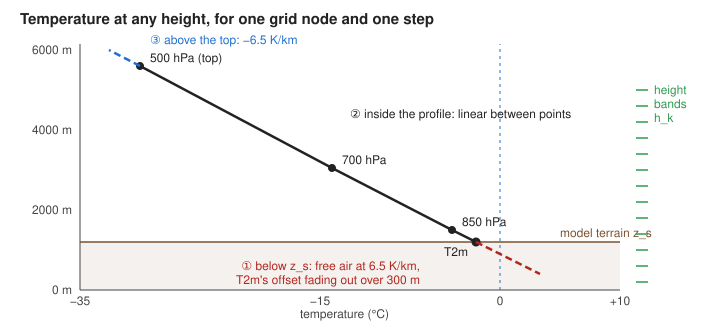
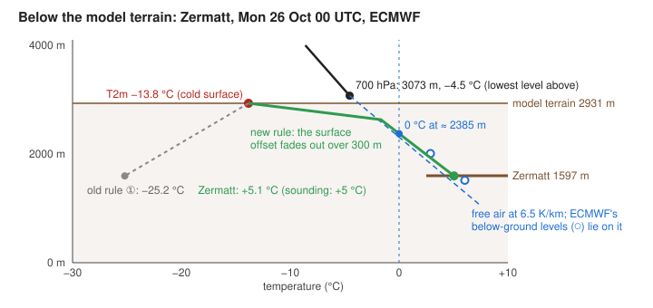

# Forecast layer: how the temperature minimum / maximum is computed

*Audience: meteorologists validating the method, and engineers working on Alpine planner. Reading time ≈ 10 minutes.*
*Status: implemented. §1–6 describe Min / Max of 2 m temperature over a period, §7 the lapse rate correction.*

Alpine planner can replace Windy's 2 m temperature layer with the **lowest or highest temperature over a time window**. The window is chosen with Windy's range selector, e.g. "tonight 18:00 → tomorrow 08:00".

This document states exactly what is done to the forecast data on the way from Windy's tiles to the map and the picker: which values are used, how they're combined in time and in space, and where the result differs from reality. Every step that changes meteorological values is listed here; the code links back to the sections.

## 1. Input data

| Item | Value |
|---|---|
| Parameter | 2 m air temperature, Windy file `temp-surface`, in Kelvin |
| Models | The model selected in Windy (ECMWF, GFS, ICON, ICON-EU, ICON-D2, AROME, …) |
| Run | The run Windy currently shows for that model (`refTime`). A new run replaces the old one completely; runs are never mixed. |
| Grid | Windy's tiles: the model field resampled by Windy's tile server onto 257 × 257 nodes per map tile (Web Mercator, corner-registered: node `k` lies exactly on the tile edge for `k = 0` and `k = 256`). The resampling from the model grid to the tiles is Windy's and isn't described here. |
| Tile zoom | The same tiles Windy uses for the current map zoom, typically zoom 3–6, i.e. ~1.5–20 km per node. The zoom depends on the model's data quality setting. |

### 1.1 Quantisation: 8 bits per tile

Each tile stores the values as bytes `b = 0 … 255` with a per-tile range:

```
T = min + b · step,     step = (max − min) / 255
```

Typical steps are 0.08–0.14 K, so the rounding error is at most half a step, **≤ 0.07 K**.

### 1.2 PNG, not JPEG

Windy's own temperature layer uses JPEG tiles, which add compression noise on top of the quantisation. We measured both formats on 8 models (22 Oct 2026):

| | Typical (p99) | Worst |
|---|---|---|
| JPEG noise | 0.2–0.7 K | ~2.3 K |
| PNG noise | 0 (lossless; only the quantisation in §1.1) | 0 |

A **maximum over many steps picks up the positive noise peaks**, and a minimum the negative ones. So Min / Max always reads the lossless **PNG** tiles. They have the same values and layout as Windy's JPEG, minus the noise.

These figures are exploratory measurements, not an accuracy bound or a reproducible benchmark: the original tile sample is not included here. PNG avoids this additional lossy compression, but does not remove quantisation, interpolation or forecast error. Our map and picker can therefore differ from Windy's JPEG-based single-time values.

**Code:** `src/features/forecastLayer/tempTiles.ts` (`watchTempParams`: Windy's model, run and URL; `dataZoom`; `stepTileUrl`: the PNG of each step), `src/lib/stepTiles.ts` (fetching and caching the step tiles), `src/lib/windyTile.ts` (`fetchWindyTile`: bytes, header, nodata mask), `src/features/forecastLayer/foldSource.ts` (`decode`: `T = min + b · step`).

## 2. The time window and its steps



A model's forecast exists only at its **output steps**, e.g. ECMWF hourly at first, then 3-hourly, then 6-hourly. The steps available in Windy depend on the model and on the user's subscription.

- **Window:** `[start, end]`, with `start` = the time selected on Windy's timeline and `end = start + range`. The range is set in Windy's range selector, in hours, possibly fractional.
- **Steps used:** every model step `t` with `start ≤ t ≤ end`, both ends included. `start` may lie between two steps; the step before it isn't used.
- **No interpolation in time.** Values between steps are never estimated; only the model's own output steps are compared.
- **Very short window:** if no step falls inside (a short window between two steps), the first step after `start` is used, or the last step before it at the end of the forecast. There's always at least one step.
- **Free users:** steps after the free forecast horizon (`premiumStart`) aren't available and are dropped. A step exactly at `premiumStart` is still free, as on Windy's own timeline. The panel says so ("Free forecast ends Fri 18:00: 3 steps dropped").
- The panel shows the number of steps and their spacing, e.g. "12 steps, 3-hourly".

### 2.1 Sampled extremes are biased

At each node, sampling can miss a maximum **between** two steps, making the sampled maximum too low and the minimum too high relative to that node's continuous model time series. This does not determine the sign of the final map or picker's error: spatial interpolation of node extremes introduces a separate effect (§5). For an idealised sinusoidal daily cycle with half-amplitude `A`, sampled every `Δ` hours, the worst case is:

```
error ≤ A · (1 − cos(π · Δ / 24))
```

| Spacing Δ | Error, as a share of A | For A = 5 K |
|---|---|---|
| 1 h | 0.9 % | 0.04 K |
| 3 h | 7.6 % | 0.4 K |
| 6 h | 29 % | 1.5 K |

Real daily cycles are less smooth: the night minimum is sharp, just before sunrise. So the error can be larger. The models' own "maximum/minimum since the last output" fields (ECMWF `mx2t`/`mn2t`) would avoid this bias, but Windy doesn't serve them as tiles.

**To validate:** is the step spacing shown in the panel enough of a warning, or should the result be labelled "sampled maximum"?

**Code:** `src/lib/steps.ts` (`selectSteps`; `isFreeTime`: the premium boundary, shared with the isotherm mask), `src/features/forecastLayer/controller.ts` (`resolve`: the window from Windy's `timestamp` and `acRange`, the premium status from `hasAny()`); the panel text in `src/features/forecastLayer/ForecastLayerPanel.svelte`.

## 3. Combining the steps: min / max per grid node

For each grid node `i` of each tile, over the steps `s` of the window:

```
Max:  F_i = max_s T_s,i        Min:  F_i = min_s T_s,i
t_i  = the step at which the extreme occurs (the earliest one if several are equal)
```

- **No data:** a node without data in **any** step (outside a regional model's domain) has no data in the result. Regional domains don't move between steps, so this only matters at domain edges.
- **Nothing else:** there's no weighting, smoothing or averaging. With one step, the result equals that step's field.
- **A failed step** (after one retry) is left out. Missing the decisive step can make Max too low or Min too high, so **the status line says how many steps failed** (e.g. `12 steps, 3-hourly · 2 failed`) for as long as the result is incomplete.

**Code:** `src/features/forecastLayer/fold.ts` (`createFold`), `src/features/forecastLayer/foldSource.ts` (`acquire`, `foldStep`: each step folded into its tile as it arrives; `stats`: progress in steps, `failedSteps`), `src/features/forecastLayer/forecastStatus.ts` (the status line, with `· N failed`).

## 4. From grid nodes to the map (spatial interpolation)

The folded node values `F_i` are drawn **exactly as Windy draws its own temperature layer**. We reproduced Windy's rendering and verified it against Windy's own layer, visually (alternating the two layers, at zoom 4–13, with a customised palette, on desktop and phone) and with a value readout.

1. **Bicubic interpolation between nodes:**
   - each map tile at about the screen's resolution is computed once, from its 4 × 4 surrounding nodes, with a Catmull-Rom cubic spline;
   - the result is **clamped** to the minimum and maximum of the 2 × 2 nodes around the point, so the spline can't invent values above or below its neighbours (no overshoot);
   - it's also clamped to the range of the tile's folded values.
   - nodes without data are filled with a neighbouring node's value first, so the spline near a domain edge doesn't see a meaningless number;
   - a point whose 2 × 2 nodes are mostly without data (bilinear weight > 0.33) is drawn grey, as in Windy.
2. **Colour:** the value is looked up in Windy's temperature colour scale (2048 colours over a fixed Kelvin range, including the user's customised palette).
3. **On screen:** the coloured tiles are drawn with bilinear filtering of the colours.

Order matters: **the extreme is taken per node first, then interpolated in space.** Interpolating first and then taking the extreme gives a different field (§5); the difference is not bounded by the quantisation error.

**Code:** `src/features/forecastLayer/foldSource.ts` (`pack`: the nodata fill), `src/features/forecastLayer/layer.ts` (the two passes), `src/features/forecastLayer/shaders.ts` (`COLOR_FS`: bicubic, clamps, colour, nodata grey; `DRAW_FS`), `src/features/forecastLayer/colorLut.ts` (the colour scale).

## 5. The picker (clicked value)

Without the lapse rate correction, the picker uses the **same folded node values** `F_i` as the map, but interpolates them **bilinearly** between the 2 × 2 surrounding nodes. The map uses bicubic interpolation followed by colour filtering (§4), so the displayed colour and picked number need not agree exactly. With the correction, the map and picker also use different vertical coordinates (§7.6–7.8).

The **time of the extreme** in the picker ("Wed 14:00") is the step at which the **bilinear point series** `T_s(point)` reaches its extreme.

For a point between nodes, the bilinear interpolation of the node maxima is **≥** the maximum of the interpolated point series (≤ for minima). The two are equal at a node, and whenever the surrounding nodes peak at the same step. They differ where the extreme's time changes between neighbouring nodes, e.g. as a front passes. The map and picker number interpolate node extremes; the picker time comes from the point series. **The displayed temperature need not occur at the displayed time, or at any step at that point.**

For example, take two columns of nodes at 0 / 10 °C at the first step and 10 / 0 °C at the second. Halfway between them, the point series is 5 / 5 °C, but the interpolated node maximum is 10 °C. The picker shows 10 °C and the first step's time (the earliest tie). This is a spatial envelope, not the point series' maximum.

**To validate:** should the picker value be the point series' own extreme instead? It would match the time shown, but not the map colour.

**Code:** `src/features/forecastLayer/fold.ts` (`foldPoint`), `src/features/forecastLayer/foldSource.ts` (`sample`, `locate`), `src/features/forecastLayer/tempTiles.ts` (`pickerDataZoom`), `src/features/forecastLayer/controller.ts` (the interpolator and `decoratePicker`).

## 6. Limitations

- **Sampled, not true extremes** (§2.1).
- **Model grid scale:** the values represent model grid cells of 1.5–20 km at the model's smoothed terrain height. Valleys, ridges and local effects are not resolved; the lapse rate correction (§7) addresses the height difference, not the local effects.
- **One run:** the window uses only the current run; earlier hours of the window aren't "analysis" but the same forecast.
- **The rest of the map:** wind particles, isolines and the point forecast stay at the single time `start`.

## 7. Lapse rate correction

### 7.1 The problem

A model's 2 m temperature is valid near the **model terrain** `z_s`: the smoothed ground used by the model. Real valleys can lie more than 1000 m below it, and summits can lie well above it. With temperature decreasing upward, that height mismatch tends to make an uncorrected valley too cold and a summit too warm. Inversions and local surface effects can reverse that expectation; 6.5 K/km is a reference lapse rate, not a universal correction.

The correction estimates the temperature **at the real terrain height `h`** (our ~90 m elevation data), from the model's own vertical temperature profile. Terms like lapse rate and inversion are explained in [`freezing-mask-algorithm.md`](freezing-mask-algorithm.md) §1.

**Code:** `src/features/forecastLayer/controller.ts` (the correction's availability per model: `checkCorrection`, `modelLevels`), `src/features/forecastLayer/correctedSource.ts` (the source).

### 7.2 Inputs (per step, in addition to §1)

| Field | Tile | Use |
|---|---|---|
| Model terrain `z_s` | `gh-surface` from the model's analysis (static) | where T2m is valid |
| Temperature on pressure levels | `temp-<level>`, PNG | the profile above the model terrain |
| Height of pressure levels | `gh-<level>` (geopotential height, m), PNG | where each level's temperature is valid |

- **Levels:** 950, 925, 900, 850, 800, 700, 600 and 500 hPa, where the model serves them.
- **Only the levels a tile can use are fetched** (§7.7).
- **Per node:** levels at or below the model terrain (`gh ≤ z_s`, e.g. 950 hPa over the Alps) aren't forecast air: the model fills them by extrapolating downward. They never enter the profile itself (rules ② and ③ of §7.3). **One exception:** the highest of them, the level just below `z_s`, is used together with the lowest level above `z_s` to interpolate the free-air temperature at the model terrain, `T_free(z_s)` (§7.3). All levels further below are ignored.
- T2m is taken as valid at `z_s`; the 2 m offset is neglected.

**Code:** `src/features/forecastLayer/correctedSource.ts` (`loadStatic`: the model terrain via `loadTerrain` in `src/features/elevationMask/deg0.ts`; `stepFiles`, `requestStep`, `correctedStep`: the files per step, a failed level dropped), `src/features/forecastLayer/tempTiles.ts` (`stepTileUrl`), `src/lib/stepTiles.ts`.

### 7.3 Temperature at height `h` (one node, one step)



The **profile** of a node is the point `(z_s, T2m)` plus every level above `z_s` as `(gh, T)`, sorted by height. Then:

```
① h ≤ z_s (below the model terrain):   T(h) = T2m + Γ_s · d + w · Δ          d = z_s − h,  w = min(1, d / 300 m)
② z_s < h ≤ top of the profile:        T(h) = linear interpolation between the two profile points around h
③ h > top (highest usable level):      T(h) = T_top − 6.5 K/km · (h − gh_top)

with  Γ_s = 6.5 K/km                                  (standard lapse rate)
      Δ   = T_free(z_s) − T2m                          (the surface offset)
      T_free(z_s) = linear interpolation at z_s between L_below and L0
                    L0:      the lowest usable level above z_s
                    L_below: the highest level at or below z_s (a value the model itself extrapolated below its ground)
      without L_below:  T_free(z_s) = T_L0 + Γ_s · (gh_L0 − z_s)
      without L0:       Δ = 0
```

The three parts join continuously at `z_s` and at the top. A node without any usable level has the profile `(z_s, T2m)` alone: ② is empty, ③ starts at `z_s`, and ① is `T2m + 6.5 K/km · d`.

**What ① means.** Below the model terrain there is no forecast air, so ① builds it from two pieces:

- **The free air,** taken at the model terrain from the two pressure levels around it and continued downward at the standard lapse rate: `T_free(h) = T_free(z_s) + Γ_s · (z_s − h)`. Deep below the model terrain (`d ≥ 300 m`), ① is exactly this.
- **Why two levels around `z_s`, not just the lowest one above it.** With only the lowest level above `z_s`, a level crossing the model terrain (from one node to the next, or by 8-bit rounding of its height) would switch the free-air reference abruptly to the next level up, which can lie above a strong inversion: a jump of 10 K or more. Interpolating between the level just below and the level just above `z_s` changes continuously when a level crosses. The level below the terrain is the model's own extrapolated value, but it's only used to interpolate at `z_s` itself.
- **The surface offset** `Δ`: how much the model's 2 m air differs from that free air at the model ground. A cold surface layer over snow on a clear night gives a large positive `Δ` (T2m far below the free air); sun-heated ground gives a negative one. ① keeps this offset at the model terrain, where the model computed it, and **fades it out linearly over the first 300 m below**. The offset belongs to the model's smoothed surface, not to a valley a kilometre lower.



**Worked example: Zermatt** (46.024° N 7.753° E, real height 1597 m; ECMWF run 23.10.2026 06 UTC, values interpolated at the point). The model terrain is 2931 m, so Zermatt lies `d = 1334 m` below it.

| Mon 26.10. | T2m at 2931 m | Lowest level above (700 hPa) | `T_free(z_s)` | `Δ` | ① at 1597 m | ECMWF's 850 / 800 hPa below ground |
|---|---|---|---|---|---|---|
| 00 UTC | −13.8 °C | 3073 m, −4.5 °C | −3.55 °C | +10.3 K | **+5.1 °C** | +6.0 °C at 1516 m, +2.9 °C at 2008 m |
| 06 UTC | −10.4 °C | 3090 m, −1.0 °C | 0.0 °C | +10.4 K | **+8.7 °C** | +9.4 °C at 1516 m, +6.2 °C at 2013 m |
| 12 UTC | −0.8 °C | 3110 m, −0.3 °C | +0.85 °C | +1.7 K | **+9.5 °C** | +9.9 °C at 1533 m, +6.7 °C at 2031 m |

`T_free(z_s)` is interpolated between the 800 hPa level (below the model terrain, the model's own extrapolated value) and the 700 hPa level above it.

Windy's sounding for that point at 00 UTC drew ECMWF's below-ground levels too: +5 °C at 1603 m. Windy's ECMWF meteogram showed −15 °C, the uncorrected T2m of the smoothed terrain. These are recorded forecast examples, not observations. The rounded 00 UTC inputs are preserved in [`src/lib/profile.test.ts`](../src/lib/profile.test.ts) and [`src/features/forecastLayer/heightTemperature.test.ts`](../src/features/forecastLayer/heightTemperature.test.ts), so the arithmetic can be reproduced with `npm test`; this does not reproduce the original live tile retrieval or validate the real valley temperature.

**Why the free air, and why 6.5 K/km below ground.**

- **Comparison with ECMWF extrapolation.** ECMWF also fills pressure levels below the terrain by extrapolating downward. Its [ERA5 documentation, note 14](https://confluence.ecmwf.int/spaces/CKB/pages/76414402/ERA5%2Bdata%2Bdocumentation) explains that below-surface values fill otherwise empty regions and describes temperature extrapolation; the [IFS CY49R1 documentation, Part I](https://www.ecmwf.int/sites/default/files/elibrary/112024/81623-ifs-documentation-cy49r1-part-i-observations.pdf) describes related below-orography processing. These references explain the distinction between modelled air and extrapolation; they do not validate this plugin's 300 m fade or specify every provider's current processing. At Zermatt the recorded below-ground levels change by 6.2–7.0 K/km. ① agrees with those values and Windy's sounding to within about 1 K in this example. That is consistency with another extrapolation, **not** agreement with an observed valley temperature.
- **The near-surface lapse rate fails here.** An earlier version of ① extrapolated with Γ of the lowest 500 m of the profile, clamped to −8 … +9.8 K/km. At Zermatt 00 UTC that layer is the cold surface layer (Γ = −15.7 K/km, clamped to −8), so it extrapolated an inversion 1.3 km down: **−25.2 °C**, against +5 °C in ECMWF's own below-ground data. Even at 12 UTC it gave +0.8 °C, against about +9.5 °C. The cold surface layer of a smoothed, snow-covered model terrain says nothing about the air in a valley more than a kilometre below it.
- **Why fade over 300 m, not drop the offset at once.** Without the fade, the temperature would jump by `Δ` (10 K at Zermatt) wherever the real terrain crosses the model terrain, i.e. halfway up many slopes. The fade keeps the result continuous and lets the offset matter only close to the model terrain. The 300 m depth is a **tunable hypothesis** (a typical depth of a nocturnal surface layer), not a validated constant: it should be checked against valley and ridge observations, separately for clear nights, snow cover, season and the height difference to the model terrain.

**To validate:**

- **Unresolved valley cold pools.** On clear nights, a real valley floor can be colder than the free air at its height. ① follows the free air deep below the model terrain, so it can be too warm there. Should a fraction of `Δ` be kept deeper down at night, or should the fade depth depend on `d`? Assess this against observations, not just another forecast.
- **Warm air aloft over a cold valley, by day.** Zermatt, Tue 27.10. 09 UTC (same run): 700 hPa at 3158 m is +6.4 °C, so ① gives **+16.5 °C** at 1597 m, close to ECMWF's own below-ground 850 hPa (+15.7 °C at 1552 m). T2m on the model terrain (2968 m) is −0.4 °C, a surface offset `Δ ≈ +8 K`. This does not establish the real valley temperature. Keeping half of `Δ` at depth would give about +12.5 °C, all of it +8.5 °C; these are sensitivity examples, not validated alternatives. With Max, such steps can set the result. Should the fraction of `Δ` kept below 300 m depend on the time of day, the season or `Δ` itself?
- **The 300 m fade depth.**
- **The levels around `z_s` can lie in the model's surface layer** when they're close to `z_s`. Then `T_free(z_s)` carries part of the surface offset. Should they be required to lie some distance from `z_s`?

Part ② is the model's **free-atmosphere** temperature at the summit's height, not the near-surface temperature of the summit itself, which sun and radiation make warmer or colder. **To validate:** is the free-air value the right one for summits and ridges?

**Code:** `src/lib/profile.ts` (`buildProfile`: the profile, and `L_below` kept aside; `surfaceOffset`: `L0`, `L_below`, `T_free(z_s)` and `Δ`; `temperatureBelow`: ①; `STANDARD_LAPSE_RATE`, `FADE_DEPTH`; shared with the isotherm mask), `src/features/forecastLayer/heightTemperature.ts` (`temperatureAtHeights`: ①②③ in one pass over the heights; `temperatureAt`: one height with its branch, `L0`, `L_below`, `Δ`, `d` and `w`).

### 7.4 Order with Min / Max: correct each step, then take the extreme

For every node `i` and step `s`, the corrected `T_s,i(h)` is computed first. The extreme is then taken over the steps, for each height:

```
F_i(h) = max_s T_s,i(h)        (min for Min)
```

The correction isn't linear across steps (the surface offset and the profile change), so the extreme of the corrected values is not the corrected extreme. With Instant + correction, there's one step and no fold.

**Code:** `src/features/forecastLayer/bands.ts` (`foldStepNodes`), `src/features/forecastLayer/correctedSource.ts` (`queueStep`: each step corrected and folded from `src/lib/foldQueue.ts`, in row slices).

### 7.5 Height bands: how a height-dependent extreme reaches the map

`F_i(h)` depends on the height of each screen pixel, so it can't be stored as one number per node. Per node it's evaluated at **K heights relative to the node's own model terrain**, the *height bands*:

```
h_k,i = z_s,i + o_k        o_k = o_lo + k · S,   k = 0 … K − 1
bottom = max(e_min − 200 m, −500 m)
top    = min(e_max + 1500 m, 9000 m)
o_lo   = min(S · floor((bottom − max z_s) / S), −300 m)
o_hi   = max(S · ceil((top − min z_s) / S), 0 m)
K      = (o_hi − o_lo) / S + 1
hi     = max(top, max z_s)                  (for pressure-level selection, §7.7)

Try S = 150 m; if K > 48, recompute with S = 300 m.
```

`e_min` / `e_max` are the real terrain's range over the tile, from our elevation tile at the same zoom. That tile is averaged down from 90 m data, so its maximum is well below the real summits; hence the 1500 m margin.

The −500 / 9000 m limits constrain `bottom` and `top`, **not every node's absolute band heights**. Shared relative offsets, outward rounding and the mandatory offsets 0 and −300 m can put bands outside those absolute limits. For example, model terrain spanning 0–5000 m and real terrain spanning 0–7000 m produce `o_lo = −5400 m`, `o_hi = 8700 m`, `S = 300 m`, `K = 48`; the lowest node has a band at −5400 m and the highest one at 13700 m. The 48-band threshold selects spacing; it is not a hard cap on the final count.

**Why relative to the model terrain.** The profile of §7.3 has sharp corners, and straight lines between bands cut through corners. The sharpest ones sit at fixed distances from each node's own model terrain: at `z_s` itself (where the surface temperature meets the air above, often a strong surface inversion on clear nights) and at `z_s − 300 m` (the end of the fade). With offsets that are multiples of 150 m, **both corners fall exactly on a band for every node**. With bands at the same absolute heights for all nodes, as in the first version, those corners fell between bands and an inversion could be smoothed away: a surface temperature of −1.5 °C under air of +4 °C 100 m higher came out as +2.85 °C at the model terrain.

Between two bands, `F_i(h)` is interpolated **linearly in height**. The remaining errors:

- **Pressure-level corners** still fall between bands. For an isolated corner within a band interval the error is bounded by `|ΔΓ| · S / 4`, where `ΔΓ` is the change of slope at the level: 0.75 K for a 20 K/km change and 150 m bands, or 1.5 K with 300 m bands. Stronger slope changes give larger errors; multiple corners require considering the whole interval. These are conditional bounds, not a universal accuracy guarantee.
- **Folds:** for Min / Max, `F_i(h)` is an extreme of piecewise-linear curves and can bend between bands. An isolated change of the winning step has the same bound using the difference between the steps' slopes.
- Heights outside the band range take the nearest band's value (rare; counted in debug).

**Code:** `src/features/forecastLayer/bands.ts` (`bandRange`: `o_lo`, `S`, `K`; `foldStepNodes`: each node at its own heights `z_s + o_k`; `createBandFold`, `bandFoldRange`), `src/features/forecastLayer/correctedSource.ts` (`staticData`: the bands and the filled `z_s` per tile; `packBands`: °C, R16F).

### 7.6 From bands to the map

For each screen texel of a map tile:

1. **Real height `h`:** from our elevation tiles, bilinear: the tile at the map tile's zoom, up to zoom 10 (~90 m data), or a coarser one while it loads (up to 4 zoom levels). At low zoom the real terrain is therefore itself averaged, like the map; summits and valleys sharpen as you zoom in.
2. **Height relative to the model terrain:** `r = h − z_s(texel)`, with `z_s` interpolated bilinearly between the nodes.
3. **Value:** at the two bands around `r`, the same bicubic interpolation between nodes as §4 (Catmull-Rom, clamped to the 2 × 2 neighbours at that band), then linear between the two bands. Between nodes this interpolates values at the same height *above or below each node's model terrain* (terrain-following). This is the plugin's interpolation rule, not a claim to reproduce each forecast model's interpolation scheme.
4. **Colour, nodata and drawing:** as §4.

The correction therefore adds terrain detail at the elevation data's resolution: valleys and ridges become visible in the temperature field. Above MapLibre zoom 10.5, Windy's opaque topographic map covers all weather layers, ours included.

**Map and picker.** The picker (§7.8) evaluates the exact profile at the clicked point, without bands. At a node, for the same height and input data, the two agree up to band and texture rounding errors; their elevation resolution can also differ. Between nodes they additionally differ by the interpolation (terrain-following on the map, the four nodes' exact values at one absolute height in the picker).

That difference can be several degrees and can change the sign of the temperature. Consider one step with model terrain at 1000 and 2000 m, T2m = −1.5 °C at both nodes, and a pressure-level sample at 2100 m with +4 °C at both nodes. Halfway between them, let the real height be 1500 m. The map has `r = 0` and interpolates both surface values, giving −1.5 °C. The picker evaluates both profiles at 1500 m: +1.0 and +7.9 °C, averaging to +4.45 °C. Repeat these columns in the other horizontal direction for the 2 × 2 case. This is a synthetic illustration of the implemented rules, not an observed forecast error or a band interpolation error.

**Code:** `src/features/forecastLayer/shaders.ts` (`COLOR_BANDS_FS`: `r = h − z_s`, the bands around `r`), `src/features/forecastLayer/layer.ts` (`upload`: the bands as an R16F `TEXTURE_2D_ARRAY` and `z_s` as R32F; `elevationFor`: the elevation tile per render tile; `colorTile`; `countClamps`), `src/features/forecastLayer/elevationTiles.ts`.

### 7.7 Which pressure levels are fetched for a tile

For each level, its **standard-atmosphere height** is used to judge whether the tile can use it:

| Level (hPa) | 950 | 925 | 900 | 850 | 800 | 700 | 600 | 500 |
|---|---|---|---|---|---|---|---|---|
| Height (m) | 540 | 762 | 988 | 1457 | 1949 | 3012 | 4206 | 5574 |

A tile fetches the levels whose standard height lies in `[min z_s − 600 m, hi + 600 m]` (§7.5; real level heights vary by a few hundred metres with the weather), **plus one level beyond each end** where there is one.

Below the model terrain, ① needs only the two levels around it: the lowest one above and the highest one at or below it (§7.3). The download range therefore starts around the tile's lowest model terrain, not its lowest real terrain. The margin and the "one level beyond" extend this range. A tile can include several levels below a particular node's terrain; per-node evaluation uses only the highest of those levels for the surface offset.

This only limits downloads. Per node, §7.3 still decides which fetched levels are used.

**Code:** `src/features/forecastLayer/bands.ts` (`levelsForRange(zsMin, hi, available)`: the one beyond the low end is the level just below the model terrain; `STANDARD_HEIGHTS`, `LEVEL_MARGIN`), `src/features/forecastLayer/correctedSource.ts` (`staticData`: the tile's lowest model terrain).

### 7.8 The picker with the correction

1. **Real height** `h` at the clicked point: from the 90 m elevation data (zoom 10), bilinear.
2. **Node values, exactly:** for each of the 2 × 2 surrounding nodes and each step, `T_s,i(h)` (§7.3) at **that `h`**, not band-interpolated.
3. **Value:** the bilinear interpolation of the node extremes `max_s T_s,i(h)` (min for Min). This uses one absolute height at all four nodes; the map uses one relative height instead (§7.6). The value is therefore not guaranteed to match the map colour.
4. **Time of the extreme:** the step at which the bilinear point series `Σ w_i T_s,i(h)` reaches its extreme, as in §5. That series' extreme can differ from the displayed value; the time does not assert when the displayed value occurs.
5. **Display:** the picker shows the height used on its second line, e.g. "Wed 14:00 · 1,840 m", or "1,840 m" in Instant mode, in Windy's elevation units (m or ft, as the user set them) and Windy's number grouping.

**Code:** `src/features/forecastLayer/correctedSource.ts` (`sample`, `pointSeries`), `src/features/forecastLayer/elevationTiles.ts` (`elevationAt`), `src/features/forecastLayer/fold.ts` (`foldPoint`), `src/features/forecastLayer/controller.ts` (`decoratePicker`).

### 7.9 Limitations of the correction

- **It's an estimate.** Below the model terrain it's the free air at the standard lapse rate, plus the model's surface offset fading over 300 m. Real valley cold pools (clear nights) are colder than that, and sun-heated slopes warmer.
- **Free-air above the model terrain** (§7.3).
- **Grid-scale profile:** each node's profile represents a 1.5–20 km cell; the bilinear interpolation between nodes doesn't know about ridges between them.
- **Band interpolation** (§7.5): the error depends on spacing and profile slopes. For an isolated 20 K/km slope change, the bound is 0.75 K with 150 m bands or 1.5 K with 300 m bands; stronger changes can exceed these values. The corners at the model terrain and at the end of the fade are exact at each node.
- **Map versus picker** (§7.6–7.8): their different vertical and horizontal interpolation can produce larger differences, separate from band error. Min / Max values and times also describe different statistics (§5).
- **Real terrain at the map's resolution** (§7.6): at low zoom the elevation itself is averaged, so the map shows the correction for averaged terrain; the picker always uses the zoom 10 height.

**To validate** (added with the implementation):

- **Nodes without a usable level** (the model terrain above every fetched level, e.g. high plateaus with 500 hPa missing): ① and ③ then run from T2m with 6.5 K/km and no surface offset. Is the standard lapse rate acceptable there, or should the correction be off for such nodes?
- **Averaged real terrain at low zoom** (§7.6): acceptable as "what the map shows at this zoom", given that the picker uses the zoom 10 height?

**Code:** none (limitations).

## 8. Constants

| Name | Value | Meaning |
|---|---|---|
| Format | PNG | lossless tiles for Min / Max (§1.2) |
| Step inclusion | `start ≤ t ≤ end` | §2 |
| Tie rule | earliest step | §3 |
| Nodata rule | nodata in any step → nodata | §3 |
| Display | Catmull-Rom bicubic, clamped to the 2 × 2 neighbours | Windy's, §4 |
| Picker | bilinear, 2 × 2 neighbours | Windy's, §5 |
| Lapse rate below the model terrain and above the top | 6.5 K/km | standard atmosphere, §7.3 |
| Surface offset fade depth | 300 m | a tunable hypothesis, §7.3 |
| Bands | relative to each node's model terrain, every 150 m (300 m if more than 48 bands would be needed) | §7.5 |
| Band margins | 200 m below the lowest real terrain, 1500 m above the averaged real terrain maximum | §7.5 |
| Level margin | ± 600 m around `[min z_s, hi]`, plus one level each side | §7.7 |

**Code:** `src/lib/steps.ts`, `src/features/forecastLayer/fold.ts`, `src/lib/stepTiles.ts` (`MAX_IN_FLIGHT`, `CACHE_BYTES`, `ATTEMPTS`), `src/features/forecastLayer/layer.ts` (`UPLOAD_INTERVAL_MS`); for §7: `src/lib/profile.ts` (`STANDARD_LAPSE_RATE`, `FADE_DEPTH`), `src/features/forecastLayer/bands.ts` (band spacing and margins, `MAX_BANDS`, level margin, `STANDARD_HEIGHTS`).
