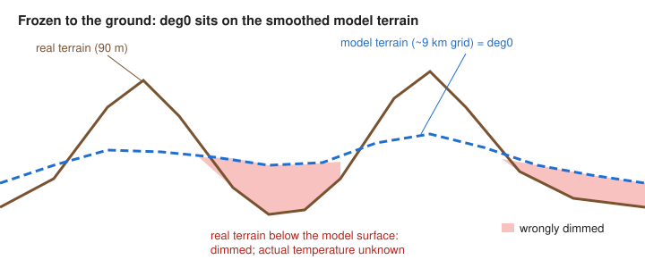
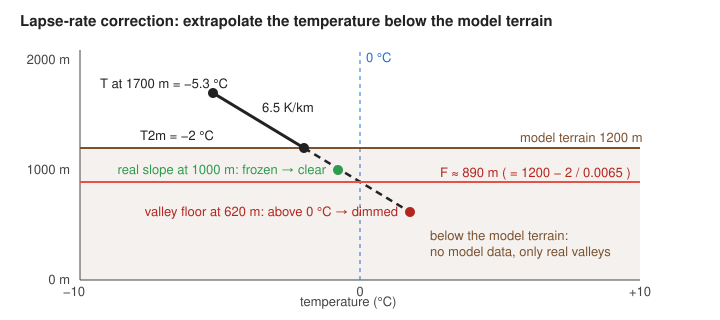

# Freezing mask: how the effective freezing level is computed

*Audience: meteorologists validating the method, and engineers working on Alpine planner (§1 explains the terms). Reading time ≈ 10 minutes.*

The freezing mask dims terrain **below an effective freezing level** and keeps terrain at or above it clear. This is an estimate of where air may be below 0 °C, not a direct temperature measurement or a test of whether snow or ground is frozen. It compares, per screen pixel:

```
h   = real terrain height        (our 90 m elevation layer)
F   = effective freezing level   (from forecast model data, this document)
dim if  h < F + offset           (offset: user slider, −500 … +500 m)
```

Everything hard is in computing `F`. A naive `F` (just the model's freezing level) is wrong in many places, especially in valleys and plains on cold days. This document explains why, and how the plugin corrects it.

## 1. Terms you need

| Term | Meaning |
|---|---|
| **Freezing level** / **0 °C isotherm** | The height at which the air temperature is exactly 0 °C. Below it the air is warmer, above it colder (normally). |
| **deg0** | Windy's "freezing altitude" layer: the forecast freezing level in **metres above sea level**, as defined by the model provider and served by Windy. Where several 0 °C crossings exist, this single field cannot describe them all. The crossing-selection rule has not been verified per supported model; the plugin uses the supplied field rather than finding all crossings itself. |
| **Forecast model, grid** | ECMWF, ICON, … compute the weather on a grid, e.g. ECMWF ≈ 9 km, ICON-D2 ≈ 2 km. Every value describes a whole grid cell, not a point. |
| **Model terrain** (orography) | The ground height *the model believes in*: the real terrain averaged over each grid cell. It's much smoother than reality: valleys are filled up, summits cut down. Windy serves it as `gh-surface` (analysis). |
| **T2m** | Air temperature 2 m above the **model** terrain (`temp-surface`, Kelvin). |
| **Pressure levels** | The model also reports temperature at fixed air pressures: 950, 925, 900, 850, 800, 700, 600, 500 hPa. Pressure drops with height, so each level is a surface at a varying height, roughly 0.5, 0.8, 1.0, 1.5, 2.0, 3.0, 4.2, 5.6 km. |
| **Geopotential height** (`gh-<level>`) | The height in metres of a pressure level at a given place and time. Together with `temp-<level>` it gives a **(height, temperature)** sample of the air above. |
| **Lapse rate Γ** | How fast temperature **falls** with height, in K/km (1 K = 1 °C difference). Γ = 6.5 K/km means 6.5 °C colder per km up. |
| **Standard lapse rate** | 6.5 K/km: the average of the lower atmosphere in the ICAO standard atmosphere. A default, not a measurement. |
| **Dry adiabatic lapse rate** | 9.8 K/km: rising dry air cools at this rate. Well-mixed air (sunny afternoon) is close to it. More is physically unstable and rare. |
| **Moist (saturated) lapse rate** | ≈ 4–7 K/km: in cloud, condensation releases heat, so the air cools more slowly. |
| **Inversion** | A layer where temperature **rises** with height (Γ < 0). Typical on clear nights and in winter, when cold air sinks into valleys ("**cold pool**"). |

## 2. The data the plugin uses

All are standard Windy 257 × 265 tiles from `ims.windy.com`, fetched as **lossless PNG** (JPEG noise would break the comparisons below). They come from one model, run and forecast time (the "context"), and share one grid tile for tile.

| Field | Tile | Used for |
|---|---|---|
| `deg0` | `forecast/<model>/<run>/<time>/…/deg0-surface.png` | the freezing level |
| model terrain | `analysis/<model>/<aref>/<aref>/…/gh-surface.png` | detecting "frozen to the ground" (static per model) |
| T2m | `…/temp-surface.png` | correction only |
| `temp-<L>`, `gh-<L>` for L ∈ 950 … 500 hPa | `…/temp-<level>.png`, `…/gh-<level>.png` | correction only: the temperature profile |

Each tile stores 8-bit values with a per-tile `[min, max]`, so every value has a rounding error of up to one **step** = (max − min) / 255. That's typically 3–15 m for heights, and less than 0.2 K for temperatures.

**Code:** `src/features/elevationMask/deg0.ts` (`resolveDeg0Model`: model and run; `instantContext`: Instant's time; `forecastUrl`; `loadTerrain`: the model terrain and its `aref`), `src/features/elevationMask/tiles.ts` (`createDeg0TileCache`: the fields per tile, K → °C), `src/features/elevationMask/constants.ts` (`forecastTileUrl`, `terrainTileUrl`, `PROFILE_LEVELS`), `src/lib/windyTile.ts` (`fetchWindyTile`, `windyTileValues`: decoding and nodata).

## 3. What `deg0` says near the ground, and where it fails

The sampled tiles examined during development showed a lower limit near the model terrain. The plugin assumes this interpretation:

```
deg0 ≥ model terrain                 within the tiles' rounding
deg0 ≈ model terrain                 interpreted as a freezing level at the model surface
```

This observed floor is consistent with a freezing level limited to the model surface; it does not establish how each provider computes or encodes the field. The plugin calls a node near that floor `ground` (§4) and can estimate a crossing below it when T2m is negative. Surface frost alone does not imply `ground`: a warm layer aloft can leave the supplied freezing level above the terrain. The observed floor and provider-specific crossing rules remain assumptions to check across models and runs.

Real valleys and plains can lie hundreds of metres **below** the smoothed model surface. Comparing them with `deg0` = model surface dims them even when their actual air might be below 0 °C. Neither their lower elevation nor the model's surface temperature proves that they are frozen; the temperature of this unresolved air needs to be estimated:



**Real example** (74.99° N 109.03° E, ECMWF run 16.10.2026 00 UTC, valid 24.10. 12 UTC):

| Value | |
|---|---|
| real terrain | 166 m |
| model terrain | 216 m |
| `deg0` | 216 m (= model terrain: classified as `ground`) |
| T2m at the model terrain | −13.9 °C |
| naive result | 166 < 216 → **dimmed**; the actual temperature at 166 m is not known from T2m |

Two smaller problems exist too:

- **Rounding:** with 8-bit tiles, `deg0` may come out a few metres above the model terrain even when they're equal. The plugin treats anything within a **tolerance** `tol = step(deg0) + step(terrain) + 5 m` as "frozen to the ground".
- **Inversions** (see §7): if the supplied `deg0` represents an upper crossing, a valley under a cold pool can be frozen while `deg0` is high above it. The plugin does not reconstruct the other crossings.

**Code:** `src/features/elevationMask/freezingLevel.ts` (`freezingTolerance`).

## 4. The fix: estimate the isotherm below the model surface

Below the model terrain the model has no forecast air, so we **build a temperature profile downward** and follow it until it reaches 0 °C. The isotherm mask and the forecast layer's lapse rate correction use **the same profile**, specified in [`forecast-layer-algorithm.md`](forecast-layer-algorithm.md) §7.3 (rule ①). In short, at a depth `d = z_terrain − z` below the model terrain:

```
T(z) = T2m + Γ_s · d + w · Δ          Γ_s = 6.5 K/km,  w = min(1, d / 300 m)
Δ    = T_free(z_terrain) − T2m        the surface offset
T_free(z_terrain)                     the free air at the model terrain: interpolated between the pressure levels
                                      just below and just above it (forecast-layer-algorithm.md §7.3)
                                      (no level above it at the node: Δ = 0)
```

- **Deep below the model terrain** (`d ≥ 300 m`) this is the **free air**, continued downward at the standard lapse rate. ECMWF fills its own pressure levels below its terrain in a similar (more elaborate) way, and that's what Windy's sounding draws there; both are extrapolations, not forecast air.
- **Close to the model terrain** it starts at T2m: the model's surface air, including a cold surface layer over snow or sun-heated ground. That **surface offset** `Δ` fades out over the first 300 m below, because it belongs to the model's smoothed surface, not to a valley far below it.



In this illustrative profile, the model's surface air lies on the free-air line (`Δ = 0`), so the profile is simply 6.5 K/km downward. T2m = −2 °C at a model surface of 1200 m reaches 0 °C about 310 m lower, so `F ≈ 890 m`. The estimate is below 0 °C at 1000 m (clear) and above 0 °C at 620 m (dimmed); these are consequences of the assumed profile, not observed temperatures.

### Where the profile crosses 0 °C

`T` rises steadily going down in the free-air part (`Γ_s > 0`), so there is always a crossing, and `F` is always finite. With `T2m < 0` (the `ground` branch):

```
T_300 = T2m + Γ_s · 300 m + Δ                 the temperature 300 m below the model terrain
T_300 ≥ 0:  d0 = −T2m / (Γ_s + Δ / 300 m)     the crossing lies within the fade
T_300 < 0:  d0 = 300 m − T_300 / Γ_s          the crossing lies in the free air below
F = z_terrain − d0
```

In the first case the slope `Γ_s + Δ / 300 m` is positive, because T goes from below 0 at the model terrain to at least 0 at 300 m.

### The rule, case by case

For each grid node, with `ground = deg0 ≤ terrain + tol`:

Checked in this order (the branch names are what the debug readout shows):

| Case | Branch | `F` | Why |
|---|---|---|---|
| not `ground` (isotherm above the model terrain) | `above ground` | `deg0` | the model knows the isotherm; trust it |
| `ground`, correction **off** | `ground (off)` | `terrain − tol` | the model data alone, but rounding never dims terrain at the model surface |
| `ground`, T2m ≥ 0 °C | `ground (T2m ≥ 0)` | `terrain − tol` | the isotherm is at the surface (rounding case) |
| `ground`, the crossing lies within 300 m | `fade` | `terrain − d0` | the model's surface air still matters there |
| `ground`, the crossing lies deeper | `free air` | `terrain − d0` | the free air decides |

A node without any pressure level above its terrain uses `Δ = 0`; the debug readout marks it `(no level)`. Nodata in `deg0`, the terrain or (with the correction) T2m makes the node nodata.

### Worked examples

**Zermatt** (46.024° N 7.753° E, real height 1597 m; ECMWF run 23.10.2026 06 UTC, Mon 26.10. 00 UTC). The model terrain is 2931 m; T2m there is −13.8 °C (a cold surface layer). The levels around it are 800 hPa at 2008 m, +2.9 °C (below the terrain, extrapolated by the model) and 700 hPa at 3073 m, −4.5 °C. So `T_free(2931 m) ≈ −3.55 °C` and `Δ ≈ +10.3 K`. Then `T_300 = −13.8 + 1.95 + 10.3 ≈ −1.6 °C < 0`, so `d0 ≈ 300 + 1.6 / 0.0065 ≈ 546 m` and **`F ≈ 2385 m`**. At Zermatt's height of 1597 m, the plugin estimates about +5 °C and **dims** the terrain. That's consistent with ECMWF's own below-ground extrapolation and with Windy's sounding, but both are extrapolations too; whether the real valley floor was above 0 °C that night isn't known from the model. On clear nights, cold air pooling in such valleys often makes them colder than this.

The earlier version of this rule took Γ from the lowest 500 m of the profile. Here that's the cold surface layer (an inversion), so it classified the valley as "frozen all the way down" and kept it clear. The current extrapolation instead gives about +5 °C. Neither calculation establishes the actual valley temperature. See `forecast-layer-algorithm.md` §7.3 for the comparison and primary references on below-ground extrapolation.

**Siberia** (74.99° N 109.03° E, model terrain ≈ 213 m, real terrain 166 m; ECMWF run 16.10.2026 00 UTC):

| Time | T2m | Lowest level above (950 hPa) | `Δ` | `F` | Classification at 166 m |
|---|---|---|---|---|---|
| 24.10. 00 UTC | −21.9 °C | 453 m, −14.3 °C | +9.2 K | ≈ −1750 m (`free air`) | frozen, clear |
| 24.10. 12 UTC | −13.9 °C | 372 m, −14.1 °C | +0.8 K | ≈ −1800 m (`free air`) | frozen, clear |

The tables record forecast inputs and the plugin's estimates, not observed freezing conditions. Representative rounded inputs and calculations are preserved in [`src/features/elevationMask/freezingLevel.test.ts`](../src/features/elevationMask/freezingLevel.test.ts); run `npm test` to reproduce the arithmetic. The original live tile sample is not included.

Without the correction, the "off" branch uses the supplied freezing level with the terrain-floor tolerance. With it, the plugin applies the unvalidated below-terrain estimate described above; it has not been established as the best estimate of real valley conditions.

**Code:** `src/features/elevationMask/freezingLevel.ts` (`freezingNode`: the branches, `T_300` and `d0`), `src/lib/profile.ts` (`buildProfile`, `surfaceOffset`: the profile, the levels just below and above the model terrain, `T_free` and the surface offset, shared with the forecast layer's lapse rate correction).

## 5. Why `F` is computed at grid nodes, before interpolation

The GPU shows a smooth picture by **interpolating** between grid nodes. If we interpolated `deg0`, the terrain and the temperatures separately and then applied the rules per pixel, the `ground` test and the branches would flip abruptly between nodes, leaving hard, blocky edges.

Instead, the plugin:

1. evaluates the rules **at every grid node** on the CPU, when the tiles arrive;
2. stores the result `F` in a 16-bit float texture (§6: the same texture holds `F_min` and `F_max`);
3. lets the GPU interpolate **`F` only**, then compares `h < F + offset` per pixel.

Most branches meet smoothly: the `fade` and `free air` branches join at `d0 = 300 m`, and the profile changes continuously from node to node (also when a pressure level crosses the model terrain, §4). One discontinuity remains, **at the `ground` test**:

- **Without the correction**, `F` jumps from `deg0` (just above `terrain + tol`) to `terrain − tol`: up to about `2 · tol` (≈ 20–40 m).
- **With the correction** it can jump much more. When the model has a 0 °C crossing just above its terrain while the air at the ground is well below 0 °C (a warm layer aloft), `F` switches from that crossing to the estimate below the terrain: e.g. terrain 1000 m, `tol` 25 m, T2m −5 °C, no usable level: `deg0` = 1025.1 m gives `F` ≈ 1025 m, while `deg0` = 1024.9 m gives `F` ≈ 230 m. Such columns are uncommon, and the jump sits where the model itself changes regime; it isn't smoothed.

Two last rules in the shader:

- **Sea (`h ≤ 0`)** is always dimmed. That avoids a half-dimmed coastline where `F` and `h` are both 0.
- **No data** (outside a regional model's area) is dimmed. Before upload, a nodata node's `F` is filled from a valid neighbour, and the nodata flag is interpolated separately; otherwise interpolation would mix a meaningless 0 m into the valid nodes near the edge (a 3000 m freezing level next to nodata could read as 1500 m).

**Code:** `src/features/elevationMask/freezingLevel.ts` (`effectiveFreezingLevel`), `src/features/elevationMask/tiles.ts` (`updateDeg0Texture`, `createFTexture`: the RGBA16F texture, R = G = `F` for Instant), `src/features/elevationMask/freezingLevel.ts` (`fTexels`: the texels, nodata nodes filled from a valid neighbour via `src/lib/grid.ts`), `src/features/elevationMask/shaders.ts` (`FRAGMENT_SHADER`, `u_mode == 1`: the comparison, sea and nodata), `src/features/elevationMask/layer.ts` (`findDeg0`, `deg0Rect`: the `deg0` tile under each elevation tile).

## 6. Over a time window: Min, Max and Both

With **Instant**, the mask shows one forecast time: Windy's timeline time. With **Min**, **Max** or **Both**, it shows the freezing level over a **time window** chosen in the plugin: a two-handle slider over the mask model's forecast steps.

### 6.1 What the modes mean

Per grid node `i`, over the steps `s` of the window, `F_s,i` is the effective freezing level of that step, computed exactly as for Instant (§3–§4, with or without the lapse rate correction). Then:

| Mode | Per node | Clear terrain (`h ≥ … + offset`) | Meaning |
|---|---|---|---|
| **Max** | `F_max,i = max_s F_s,i` | above the highest freezing level | frozen at **every** step: stayed frozen |
| **Min** | `F_min,i = min_s F_s,i` | above the lowest freezing level | frozen at **at least one** step: froze at some point (e.g. an overnight refreeze) |
| **Both** | both | three zones, see §6.4 | where it stayed frozen, where it froze and thawed, where it never froze |

**This classification is exact per node for the computed thresholds.** "Frozen at every step" is shorthand for `h ≥ F_s` for all `s`, which is the same as `h ≥ max_s F_s`; "frozen at some step" is `h ≥ min_s F_s`. It does not validate the temperature estimate or account for unrepresented inversions. No threshold-classification information is lost by keeping only the two extremes. (The forecast layer needs height bands because a temperature depends on `h`; a freezing level doesn't.)

The **offset** slider applies to `F_min` and `F_max` alike.

### 6.2 The window and its steps

- **The window** is `[start, end]`, both on the mask model's forecast steps: the slider's handles snap to the steps of that model's calendar. The mask's model is the one the mask already uses (Windy's selected model if it has `deg0`, otherwise ECMWF), which can differ from the model of the layer underneath, and so can its steps.
- **Steps used:** every step with `start ≤ t ≤ end`, both ends included; at least one step (the handles can't cross).
- **Free users:** the handles stop at the free forecast horizon (`premiumStart`; a step exactly at it is free, as on Windy's timeline). Instant uses the same rule.
- **Initial window:** `[timeline time, timeline time + 12 h]`, snapped to steps, whenever Min, Max or Both is chosen from Instant, when ↺ is pressed, or when no usable window exists. After that the window is independent of Windy's timeline: scrubbing the timeline changes the layer underneath, not the mask.
- **Reopening:** within 60 minutes of the last use, the saved mode and window are restored and fitted to the available steps. After that, the plugin opens with its default modes; choosing a window mode from Instant initializes a new window. See [`README.md`](../README.md#remembered-state).
- **A new run or another model:** the window keeps its absolute times and is clipped to the steps now available; if it cannot be fitted, a new initial window is used.
- **No interpolation in time:** only the model's own output steps are used, as in the forecast layer (`forecast-layer-algorithm.md` §2).

### 6.3 Combining the steps

- **Per node, per step:** `F_s,i` from that step's `deg0` (and, with the correction, T2m and the pressure levels) and the model terrain, which doesn't change between steps.
- **Fold:** the running minimum and maximum over the steps that have arrived; both are always kept, so switching between Min, Max and Both needs no new data.
- **No data:** a node without data in **any** step has no data in the result (dimmed, as for Instant). Regional domains don't move, so this only matters at domain edges.
- **A failed step** (after one retry) is left out, as in the forecast layer. Missing the decisive step can make Max look "stayed frozen" where it wasn't, so **the status line says how many steps failed** for as long as the result is incomplete.
- **Between nodes**, `F_min` and `F_max` are interpolated bilinearly on the GPU, as `F` is for Instant (§5). The meanings of §6.1 are exact at the nodes; between nodes the display is an **envelope**. Example: two neighbouring nodes with `F` of 1000 / 3000 m at one step and 3000 / 1000 m at the next. Halfway between them, each step's interpolated `F` is 2000 m, so the point never changed; the interpolated extremes are 1000 / 3000 m, so Both shows a froze-and-thawed band there. The band can therefore look wider between nodes than at any single point.

### 6.4 Display

| Zone | Condition | Dimming |
|---|---|---|
| **Min, Max** | `h < F_min/max + offset` | full (0.65), as Instant |
| **Both: never frozen** | `h < F_min + offset` | full (0.65) |
| **Both: froze and thawed** | `F_min + offset ≤ h < F_max + offset` | half (0.30) |
| **Both: stayed frozen** | `h ≥ F_max + offset` | none |

In Both, a thin line (≈ 1.5 px, the dimming colour at 0.65) marks `h = F_max + offset`, where "stayed frozen" begins. Edges are antialiased as for Instant. The sea and nodata rules of §5 apply unchanged. These display values are provisional and may be tuned.

### 6.5 Limitations specific to the window

- **Sampled extremes.** The freezing level between two steps isn't known. With 3- or 6-hourly steps, the highest freezing level of an afternoon can fall between steps, so Max can show terrain as "stayed frozen" that thawed briefly. The status line shows the number and spacing of the steps.
- **One run.** The window can only cover the current run's steps; it can't reach back before the run's first step.
- **Air, not snow.** The freezing level describes the air. Whether snow refroze also depends on radiation and cloud, and that matters more over a window than at one time.

**Code:** `src/features/elevationMask/isoWindow.ts` (`initialWindow`, `clipWindow`, `allowedSteps`: §6.2), `src/lib/steps.ts` (`selectSteps`: the window's steps; `isFreeTime`: the premium boundary, also for Instant's `instantContext`), `src/features/elevationMask/deg0.ts` (`resolveDeg0Model`, `windowContext`, `premiumLimit`), `src/features/elevationMask/isoFold.ts` (`createIsoFold`: §6.3), `src/features/elevationMask/windowTiles.ts` (`createWindowTileCache`: the step files per tile through `src/lib/stepTiles.ts`, `F` per step from `src/lib/foldQueue.ts`, a failed step left out; `stats`: `failedSteps`, including steps whose T2m failed), `src/features/elevationMask/tiles.ts` (`createFTexture`: RGBA16F, R = `F_min`, G = `F_max`, B = nodata; nodata nodes filled by `fTexels`), `src/features/elevationMask/shaders.ts` (`u_iso`: §6.4), `src/features/elevationMask/constants.ts` (`BOTH_BAND_OPACITY`, `BOTH_LINE_WIDTH_PX`), `src/features/elevationMask/isoStatus.ts` (the status line, with `· N failed`), `src/features/elevationMask/ElevationMaskPanel.svelte` (the switch, the slider and the window's lifecycle).

## 7. Limitations

- **Extrapolation is an estimate.** The air in a real valley below the smoothed model surface isn't modelled. Deep below it we use the free air at the standard lapse rate. Real valleys can be colder (night-time cold pools: then the mask dims a valley that is actually frozen) or warmer (sunny afternoons) than that. See the "To validate" points in `forecast-layer-algorithm.md` §7.3.
- **Several crossings:** when the supplied `deg0` represents an upper crossing, freezing air beneath a warm layer is dimmed. The crossing-selection rule has not been verified per model (§1). The plugin keeps `deg0` in the `not ground` branch; the correction does not reconstruct lower freezing layers.
- **Coarse grid:** a 9 km model can't resolve individual slopes or local effects.
- **Freezing level isn't the snow line.** In precipitation, snow reaches lower (often ~300 m). The offset slider is for that judgement.
- **Rounding:** 8-bit tiles give 3–15 m steps in height and < 0.2 K in temperature. These are covered by the tolerance and by using PNG.

## 8. Constants

| Constant | Value | Meaning |
|---|---|---|
| `tol` | `step(deg0) + step(terrain) + 5 m` | "frozen to the ground" tolerance, per tile |
| `STANDARD_LAPSE_RATE` (Γ_s) | 6.5 K/km | the free air below the model terrain (shared with the forecast layer) |
| `FADE_DEPTH` | 300 m | over which the surface offset fades out below the model terrain (shared) |
| Initial window | timeline time → + 12 h, snapped to steps | Min / Max / Both, §6.2 |
| Both: band dimming, edge line | 0.30; ≈ 1.5 px at 0.65 along `F_max + offset` | §6.4 (provisional) |

None of them is exposed in the UI. The user only sees the **offset** slider, the **"Lapse rate correction"** toggle, and the **Instant / Min / Max / Both** switch with the window slider. The correction is off by default; while it's off, only `deg0` and the model terrain are needed, and T2m and the pressure-level tiles aren't requested. Turning it on loads those additional fields. Turning it off reuses cached data where available; a window recomputation can request tiles again if they have left the cache.

**Code:** `src/features/elevationMask/freezingLevel.ts` (`freezingTolerance`), `src/lib/profile.ts` (`STANDARD_LAPSE_RATE`, `FADE_DEPTH`), `src/features/elevationMask/isoWindow.ts` (`INITIAL_WINDOW_MS`), `src/features/elevationMask/constants.ts` (`BOTH_BAND_OPACITY`, `BOTH_LINE_WIDTH_PX`).
